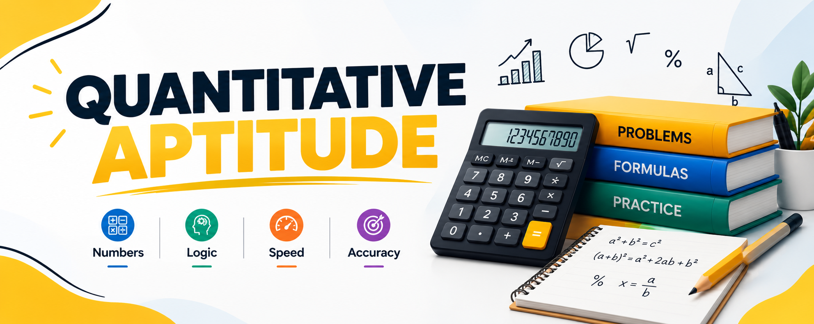

# Quantitative Aptitude

**Topics:** 26 · **Workflow:** Notes → Easy practice → Medium practice → Mistake review

## Topic roadmap

| # | Topic | Notes | Easy | Medium | Review | Status |
|---:|---|---|---|---|---|---|
| 01 | [Basic Calculation Tricks](./topics/basic-calculation-tricks/README.md) | [Notes](./topics/basic-calculation-tricks/notes/lecture-notes.md) | [Easy](./topics/basic-calculation-tricks/practice/easy.md) | [Medium](./topics/basic-calculation-tricks/practice/medium.md) | [Review](./topics/basic-calculation-tricks/review/mistakes-log.md) | Not started |
| 02 | [Simplification](./topics/simplification/README.md) | [Notes](./topics/simplification/notes/lecture-notes.md) | [Easy](./topics/simplification/practice/easy.md) | [Medium](./topics/simplification/practice/medium.md) | [Review](./topics/simplification/review/mistakes-log.md) | Not started |
| 03 | [Percentages](./topics/percentages/README.md) | [Notes](./topics/percentages/notes/lecture-notes.md) | [Easy](./topics/percentages/practice/easy.md) | [Medium](./topics/percentages/practice/medium.md) | [Review](./topics/percentages/review/mistakes-log.md) | Not started |
| 04 | [Simple Interest](./topics/simple-interest/README.md) | [Notes](./topics/simple-interest/notes/lecture-notes.md) | [Easy](./topics/simple-interest/practice/easy.md) | [Medium](./topics/simple-interest/practice/medium.md) | [Review](./topics/simple-interest/review/mistakes-log.md) | Not started |
| 05 | [Compound Interest](./topics/compound-interest/README.md) | [Notes](./topics/compound-interest/notes/lecture-notes.md) | [Easy](./topics/compound-interest/practice/easy.md) | [Medium](./topics/compound-interest/practice/medium.md) | [Review](./topics/compound-interest/review/mistakes-log.md) | Not started |
| 06 | [Ratio and Proportion](./topics/ratio-and-proportion/README.md) | [Notes](./topics/ratio-and-proportion/notes/lecture-notes.md) | [Easy](./topics/ratio-and-proportion/practice/easy.md) | [Medium](./topics/ratio-and-proportion/practice/medium.md) | [Review](./topics/ratio-and-proportion/review/mistakes-log.md) | Not started |
| 07 | [Profit and Loss](./topics/profit-and-loss/README.md) | [Notes](./topics/profit-and-loss/notes/lecture-notes.md) | [Easy](./topics/profit-and-loss/practice/easy.md) | [Medium](./topics/profit-and-loss/practice/medium.md) | [Review](./topics/profit-and-loss/review/mistakes-log.md) | Not started |
| 08 | [Average](./topics/average/README.md) | [Notes](./topics/average/notes/lecture-notes.md) | [Easy](./topics/average/practice/easy.md) | [Medium](./topics/average/practice/medium.md) | [Review](./topics/average/review/mistakes-log.md) | Not started |
| 09 | [Ages](./topics/ages/README.md) | [Notes](./topics/ages/notes/lecture-notes.md) | [Easy](./topics/ages/practice/easy.md) | [Medium](./topics/ages/practice/medium.md) | [Review](./topics/ages/review/mistakes-log.md) | Not started |
| 10 | [Partnership](./topics/partnership/README.md) | [Notes](./topics/partnership/notes/lecture-notes.md) | [Easy](./topics/partnership/practice/easy.md) | [Medium](./topics/partnership/practice/medium.md) | [Review](./topics/partnership/review/mistakes-log.md) | Not started |
| 11 | [Mixture and Alligation](./topics/mixture-and-alligation/README.md) | [Notes](./topics/mixture-and-alligation/notes/lecture-notes.md) | [Easy](./topics/mixture-and-alligation/practice/easy.md) | [Medium](./topics/mixture-and-alligation/practice/medium.md) | [Review](./topics/mixture-and-alligation/review/mistakes-log.md) | Not started |
| 12 | [Time and Work](./topics/time-and-work/README.md) | [Notes](./topics/time-and-work/notes/lecture-notes.md) | [Easy](./topics/time-and-work/practice/easy.md) | [Medium](./topics/time-and-work/practice/medium.md) | [Review](./topics/time-and-work/review/mistakes-log.md) | Not started |
| 13 | [Pipes and Cisterns](./topics/pipes-and-cisterns/README.md) | [Notes](./topics/pipes-and-cisterns/notes/lecture-notes.md) | [Easy](./topics/pipes-and-cisterns/practice/easy.md) | [Medium](./topics/pipes-and-cisterns/practice/medium.md) | [Review](./topics/pipes-and-cisterns/review/mistakes-log.md) | Not started |
| 14 | [Time Speed and Distance](./topics/time-speed-and-distance/README.md) | [Notes](./topics/time-speed-and-distance/notes/lecture-notes.md) | [Easy](./topics/time-speed-and-distance/practice/easy.md) | [Medium](./topics/time-speed-and-distance/practice/medium.md) | [Review](./topics/time-speed-and-distance/review/mistakes-log.md) | Not started |
| 15 | [Trains](./topics/trains/README.md) | [Notes](./topics/trains/notes/lecture-notes.md) | [Easy](./topics/trains/practice/easy.md) | [Medium](./topics/trains/practice/medium.md) | [Review](./topics/trains/review/mistakes-log.md) | Not started |
| 16 | [Boats and Streams](./topics/boats-and-streams/README.md) | [Notes](./topics/boats-and-streams/notes/lecture-notes.md) | [Easy](./topics/boats-and-streams/practice/easy.md) | [Medium](./topics/boats-and-streams/practice/medium.md) | [Review](./topics/boats-and-streams/review/mistakes-log.md) | Not started |
| 17 | [Numbers](./topics/numbers/README.md) | [Notes](./topics/numbers/notes/lecture-notes.md) | [Easy](./topics/numbers/practice/easy.md) | [Medium](./topics/numbers/practice/medium.md) | [Review](./topics/numbers/review/mistakes-log.md) | Not started |
| 18 | [Cyclicity](./topics/cyclicity/README.md) | [Notes](./topics/cyclicity/notes/lecture-notes.md) | [Easy](./topics/cyclicity/practice/easy.md) | [Medium](./topics/cyclicity/practice/medium.md) | [Review](./topics/cyclicity/review/mistakes-log.md) | Not started |
| 19 | [Divisibility](./topics/divisibility/README.md) | [Notes](./topics/divisibility/notes/lecture-notes.md) | [Easy](./topics/divisibility/practice/easy.md) | [Medium](./topics/divisibility/practice/medium.md) | [Review](./topics/divisibility/review/mistakes-log.md) | Not started |
| 20 | [HCF and LCM](./topics/hcf-and-lcm/README.md) | [Notes](./topics/hcf-and-lcm/notes/lecture-notes.md) | [Easy](./topics/hcf-and-lcm/practice/easy.md) | [Medium](./topics/hcf-and-lcm/practice/medium.md) | [Review](./topics/hcf-and-lcm/review/mistakes-log.md) | Not started |
| 21 | [Probability](./topics/probability/README.md) | [Notes](./topics/probability/notes/lecture-notes.md) | [Easy](./topics/probability/practice/easy.md) | [Medium](./topics/probability/practice/medium.md) | [Review](./topics/probability/review/mistakes-log.md) | Not started |
| 22 | [Permutation and Combination](./topics/permutation-and-combination/README.md) | [Notes](./topics/permutation-and-combination/notes/lecture-notes.md) | [Easy](./topics/permutation-and-combination/practice/easy.md) | [Medium](./topics/permutation-and-combination/practice/medium.md) | [Review](./topics/permutation-and-combination/review/mistakes-log.md) | Not started |
| 23 | [2D](./topics/2d/README.md) | [Notes](./topics/2d/notes/lecture-notes.md) | [Easy](./topics/2d/practice/easy.md) | [Medium](./topics/2d/practice/medium.md) | [Review](./topics/2d/review/mistakes-log.md) | Not started |
| 24 | [3D](./topics/3d/README.md) | [Notes](./topics/3d/notes/lecture-notes.md) | [Easy](./topics/3d/practice/easy.md) | [Medium](./topics/3d/practice/medium.md) | [Review](./topics/3d/review/mistakes-log.md) | Not started |
| 25 | [Mensuration](./topics/mensuration/README.md) | [Notes](./topics/mensuration/notes/lecture-notes.md) | [Easy](./topics/mensuration/practice/easy.md) | [Medium](./topics/mensuration/practice/medium.md) | [Review](./topics/mensuration/review/mistakes-log.md) | Not started |
| 26 | [Geometry](./topics/geometry/README.md) | [Notes](./topics/geometry/notes/lecture-notes.md) | [Easy](./topics/geometry/practice/easy.md) | [Medium](./topics/geometry/practice/medium.md) | [Review](./topics/geometry/review/mistakes-log.md) | Not started |

