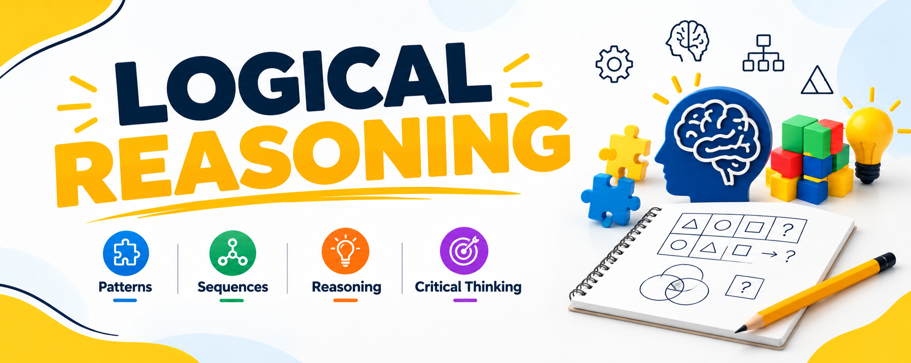

# Logical Reasoning

**Topics:** 20 · **Workflow:** Notes → Easy practice → Medium practice → Mistake review

## Topic roadmap

| # | Topic | Notes | Easy | Medium | Review | Status |
|---:|---|---|---|---|---|---|
| 01 | [Number Series](./topics/number-series/README.md) | [Notes](./topics/number-series/notes/lecture-notes.md) | [Easy](./topics/number-series/practice/easy.md) | [Medium](./topics/number-series/practice/medium.md) | [Review](./topics/number-series/review/mistakes-log.md) | Not started |
| 02 | [Letter Series](./topics/letter-series/README.md) | [Notes](./topics/letter-series/notes/lecture-notes.md) | [Easy](./topics/letter-series/practice/easy.md) | [Medium](./topics/letter-series/practice/medium.md) | [Review](./topics/letter-series/review/mistakes-log.md) | Not started |
| 03 | [Alpha-Numeric Series](./topics/alpha-numeric-series/README.md) | [Notes](./topics/alpha-numeric-series/notes/lecture-notes.md) | [Easy](./topics/alpha-numeric-series/practice/easy.md) | [Medium](./topics/alpha-numeric-series/practice/medium.md) | [Review](./topics/alpha-numeric-series/review/mistakes-log.md) | Not started |
| 04 | [Coding-Decoding](./topics/coding-decoding/README.md) | [Notes](./topics/coding-decoding/notes/lecture-notes.md) | [Easy](./topics/coding-decoding/practice/easy.md) | [Medium](./topics/coding-decoding/practice/medium.md) | [Review](./topics/coding-decoding/review/mistakes-log.md) | Not started |
| 05 | [Distance and Direction](./topics/distance-and-direction/README.md) | [Notes](./topics/distance-and-direction/notes/lecture-notes.md) | [Easy](./topics/distance-and-direction/practice/easy.md) | [Medium](./topics/distance-and-direction/practice/medium.md) | [Review](./topics/distance-and-direction/review/mistakes-log.md) | Not started |
| 06 | [Syllogism](./topics/syllogism/README.md) | [Notes](./topics/syllogism/notes/lecture-notes.md) | [Easy](./topics/syllogism/practice/easy.md) | [Medium](./topics/syllogism/practice/medium.md) | [Review](./topics/syllogism/review/mistakes-log.md) | Not started |
| 07 | [Blood Relations](./topics/blood-relations/README.md) | [Notes](./topics/blood-relations/notes/lecture-notes.md) | [Easy](./topics/blood-relations/practice/easy.md) | [Medium](./topics/blood-relations/practice/medium.md) | [Review](./topics/blood-relations/review/mistakes-log.md) | Not started |
| 08 | [Calendars](./topics/calendars/README.md) | [Notes](./topics/calendars/notes/lecture-notes.md) | [Easy](./topics/calendars/practice/easy.md) | [Medium](./topics/calendars/practice/medium.md) | [Review](./topics/calendars/review/mistakes-log.md) | Not started |
| 09 | [Cubes](./topics/cubes/README.md) | [Notes](./topics/cubes/notes/lecture-notes.md) | [Easy](./topics/cubes/practice/easy.md) | [Medium](./topics/cubes/practice/medium.md) | [Review](./topics/cubes/review/mistakes-log.md) | Not started |
| 10 | [Clocks](./topics/clocks/README.md) | [Notes](./topics/clocks/notes/lecture-notes.md) | [Easy](./topics/clocks/practice/easy.md) | [Medium](./topics/clocks/practice/medium.md) | [Review](./topics/clocks/review/mistakes-log.md) | Not started |
| 11 | [Dice](./topics/dice/README.md) | [Notes](./topics/dice/notes/lecture-notes.md) | [Easy](./topics/dice/practice/easy.md) | [Medium](./topics/dice/practice/medium.md) | [Review](./topics/dice/review/mistakes-log.md) | Not started |
| 12 | [Miscellaneous Puzzles](./topics/miscellaneous-puzzles/README.md) | [Notes](./topics/miscellaneous-puzzles/notes/lecture-notes.md) | [Easy](./topics/miscellaneous-puzzles/practice/easy.md) | [Medium](./topics/miscellaneous-puzzles/practice/medium.md) | [Review](./topics/miscellaneous-puzzles/review/mistakes-log.md) | Not started |
| 13 | [Critical Reasoning](./topics/critical-reasoning/README.md) | [Notes](./topics/critical-reasoning/notes/lecture-notes.md) | [Easy](./topics/critical-reasoning/practice/easy.md) | [Medium](./topics/critical-reasoning/practice/medium.md) | [Review](./topics/critical-reasoning/review/mistakes-log.md) | Not started |
| 14 | [Games and Tournaments](./topics/games-and-tournaments/README.md) | [Notes](./topics/games-and-tournaments/notes/lecture-notes.md) | [Easy](./topics/games-and-tournaments/practice/easy.md) | [Medium](./topics/games-and-tournaments/practice/medium.md) | [Review](./topics/games-and-tournaments/review/mistakes-log.md) | Not started |
| 15 | [Venn Diagrams](./topics/venn-diagrams/README.md) | [Notes](./topics/venn-diagrams/notes/lecture-notes.md) | [Easy](./topics/venn-diagrams/practice/easy.md) | [Medium](./topics/venn-diagrams/practice/medium.md) | [Review](./topics/venn-diagrams/review/mistakes-log.md) | Not started |
| 16 | [Linear Seating Arrangements](./topics/linear-seating-arrangements/README.md) | [Notes](./topics/linear-seating-arrangements/notes/lecture-notes.md) | [Easy](./topics/linear-seating-arrangements/practice/easy.md) | [Medium](./topics/linear-seating-arrangements/practice/medium.md) | [Review](./topics/linear-seating-arrangements/review/mistakes-log.md) | Not started |
| 17 | [Circular Seating Arrangements](./topics/circular-seating-arrangements/README.md) | [Notes](./topics/circular-seating-arrangements/notes/lecture-notes.md) | [Easy](./topics/circular-seating-arrangements/practice/easy.md) | [Medium](./topics/circular-seating-arrangements/practice/medium.md) | [Review](./topics/circular-seating-arrangements/review/mistakes-log.md) | Not started |
| 18 | [Ordering Puzzles](./topics/ordering-puzzles/README.md) | [Notes](./topics/ordering-puzzles/notes/lecture-notes.md) | [Easy](./topics/ordering-puzzles/practice/easy.md) | [Medium](./topics/ordering-puzzles/practice/medium.md) | [Review](./topics/ordering-puzzles/review/mistakes-log.md) | Not started |
| 19 | [Stack-Based Puzzles](./topics/stack-based-puzzles/README.md) | [Notes](./topics/stack-based-puzzles/notes/lecture-notes.md) | [Easy](./topics/stack-based-puzzles/practice/easy.md) | [Medium](./topics/stack-based-puzzles/practice/medium.md) | [Review](./topics/stack-based-puzzles/review/mistakes-log.md) | Not started |
| 20 | [Days and Months Puzzles](./topics/days-and-months-puzzles/README.md) | [Notes](./topics/days-and-months-puzzles/notes/lecture-notes.md) | [Easy](./topics/days-and-months-puzzles/practice/easy.md) | [Medium](./topics/days-and-months-puzzles/practice/medium.md) | [Review](./topics/days-and-months-puzzles/review/mistakes-log.md) | Not started |
