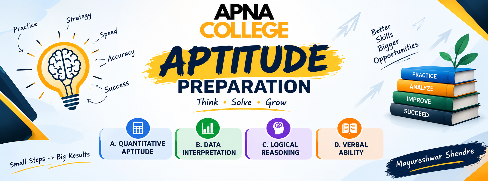

# 🎯 ApnaCollege Aptitude Preparation

### A structured, measurable, placement-focused learning journey

**Learn → Practise → Review → Improve → Perform**

*One repository. Four aptitude domains. Topic-wise practice. A complete TCS NQT revision system.*

### 👤 Mayureshwar Shendre 
  

**[Overview](#overview)** &nbsp;•&nbsp;
**[Progress](#-progress-dashboard)** &nbsp;•&nbsp;
**[Curriculum](#%EF%B8%8F-course-curriculum)** &nbsp;•&nbsp;
**[Mock Test](#-tcs-nqt-mock-tests)**;

---

## Overview

This repository organizes the ApnaCollege aptitude batch into a repeatable workflow: study each topic, capture concise notes, solve Easy and Medium practice papers, review mistakes, and validate readiness through full-length mock papers.

The curriculum is split into **Quantitative Aptitude, Data Interpretation, Logical Reasoning, and Verbal Ability**. After the topic curriculum, use the **10 TCS Ninja sample papers** (Easy to Medium) and **10 TCS Digital sample papers** (Advanced) as checkpoints.

## 📊 Progress dashboard

Progress is automatically calculated from the checkboxes in topic, practice, and mock-test Markdown files. Run the updater locally or let GitHub Actions refresh this table after every push.

<!--PROGRESS_START-->
| Learning metric | Completed / Total | Progress |
|---|---:|---|
| Topics | 0/61 | `░░░░░░░░░░` 0% |
| Easy / Medium practice papers | 0/122 | `░░░░░░░░░░` 0% |
| TCS Ninja + Digital mock tests | 0/20 | `░░░░░░░░░░` 0% |
| **Overall deliverables** | **0/203** | **`░░░░░░░░░░` 0%** |

### Section progress

| Section | Completed topics | Progress |
|---|---:|---|
| [01-quantitative-aptitude](./01-quantitative-aptitude/README.md) | 0/26 | `░░░░░░░░░░` 0% |
| [02-data-interpretation](./02-data-interpretation/README.md) | 0/5 | `░░░░░░░░░░` 0% |
| [03-logical-reasoning](./03-logical-reasoning/README.md) | 0/20 | `░░░░░░░░░░` 0% |
| [04-verbal-ability](./04-verbal-ability/README.md) | 0/10 | `░░░░░░░░░░` 0% |
<!--PROGRESS_END-->

## 🗺️ Course Curriculum

| # | Section | Topics | Learning focus | Open section |
|---:|---|---:|---|---|
| 01 | Quantitative Aptitude | 26 | Arithmetic, numbers, probability and geometry | [Explore →](./01-quantitative-aptitude/README.md) |
| 02 | Data Interpretation | 5 | Tables, charts and mixed-data analysis | [Explore →](./02-data-interpretation/README.md) |
| 03 | Logical Reasoning | 20 | Patterns, deduction, arrangements and puzzles | [Explore →](./03-logical-reasoning/README.md) |
| 04 | Verbal Ability | 10 | Grammar, vocabulary and comprehension | [Explore →](./04-verbal-ability/README.md) |

### Detailed Topic Tracker

<b>01 &nbsp;Quantitative Aptitude</b> &nbsp;(26 topics)

· Basic Calculation Tricks · Simplification · Percentages · Simple Interest · Compound Interest · Ratio and Proportion · Profit and Loss · Average · Ages · Partnership · Mixture and Alligation · Time and Work · Pipes and Cisterns · Time, Speed and Distance · Trains · Boats and Streams · Numbers · Cyclicity · Divisibility · HCF and LCM · Probability · Permutation and Combination · 2D · 3D · Mensuration · Geometry

<b>02 &nbsp;Data Interpretation</b> &nbsp;(5 topics)

· Tables · Bar Chart · Line Chart · Pie Chart · Mixed Charts

<b>03 &nbsp;Logical Reasoning</b> &nbsp;(20 topics)

· Number Series · Letter Series · Alpha-Numeric Series · Coding-Decoding · Distance and Direction · Syllogism · Blood Relations · Calendars · Cubes · Clocks · Dice · Miscellaneous Puzzles · Critical Reasoning · Games and Tournaments · Venn Diagrams · Linear Seating Arrangements · Circular Seating Arrangements · Ordering Puzzles · Stack-Based Puzzles · Days and Months Puzzles

<b>04 &nbsp;Verbal Ability</b> &nbsp;(10 topics)

· Spotting Errors · Synonyms · Antonyms · Direct and Indirect Speech · Cloze Test · Sentence Improvement · Idioms and Phrases · Substitution · Active and Passive Voice · Reading Comprehension

## 🏁 TCS NQT Mock Tests

### A. TCS NQT Ninja Tests (10 papers - Easy to Medium)

| # | Paper | Level | Score | Status |
|:-:|-------|-------|:-----:|:------:|
| 01 | [Ninja Test 1](./05-tcs-ninja-tests/test-01.md) | Easy to Medium | | ⬜ |
| 02 | [Ninja Test 2](./05-tcs-ninja-tests/test-02.md) | Easy to Medium | | ⬜ |
| 03 | [Ninja Test 3](./05-tcs-ninja-tests/test-03.md) | Easy to Medium | | ⬜ |
| 04 | [Ninja Test 4](./05-tcs-ninja-tests/test-04.md) | Easy to Medium | | ⬜ |
| 05 | [Ninja Test 5](./05-tcs-ninja-tests/test-05.md) | Easy to Medium | | ⬜ |
| 06 | [Ninja Test 6](./05-tcs-ninja-tests/test-06.md) | Easy to Medium | | ⬜ |
| 07 | [Ninja Test 7](./05-tcs-ninja-tests/test-07.md) | Easy to Medium | | ⬜ |
| 08 | [Ninja Test 8](./05-tcs-ninja-tests/test-08.md) | Easy to Medium | | ⬜ |
| 09 | [Ninja Test 9](./05-tcs-ninja-tests/test-09.md) | Easy to Medium | | ⬜ |
| 10 | [Ninja Test 10](./05-tcs-ninja-tests/test-10.md) | Easy to Medium | | ⬜ |

### B. TCS NQT Digital Tests (10 papers - Advanced)

| # | Paper | Level | Score | Status |
|:-:|-------|-------|:-----:|:------:|
| 01 | [Digital Test 1](./06-tcs-digital-tests/test-01.md) | Advanced | | ⬜ |
| 02 | [Digital Test 2](./06-tcs-digital-tests/test-02.md) | Advanced | | ⬜ |
| 03 | [Digital Test 3](./06-tcs-digital-tests/test-03.md) | Advanced | | ⬜ |
| 04 | [Digital Test 4](./06-tcs-digital-tests/test-04.md) | Advanced | | ⬜ |
| 05 | [Digital Test 5](./06-tcs-digital-tests/test-05.md) | Advanced | | ⬜ |
| 06 | [Digital Test 6](./06-tcs-digital-tests/test-06.md) | Advanced | | ⬜ |
| 07 | [Digital Test 7](./06-tcs-digital-tests/test-07.md) | Advanced | | ⬜ |
| 08 | [Digital Test 8](./06-tcs-digital-tests/test-08.md) | Advanced | | ⬜ |
| 09 | [Digital Test 9](./06-tcs-digital-tests/test-09.md) | Advanced | | ⬜ |
| 10 | [Digital Test 10](./06-tcs-digital-tests/test-10.md) | Advanced | | ⬜ |

  
## 👤 Connect: **Mayureshwar Shendre**   

⭐ Star if this helps · 🍴 Fork to add your notes · 📢 Share with your batchmates

